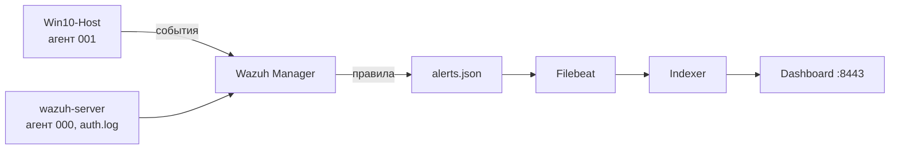

# Домашняя SOC-лаборатория на Wazuh

Учебный проект: стенд из Wazuh 4.14.9 (SIEM/XDR) и Windows 10 в VirtualBox. Я воспроизвожу типичные действия атакующего, нахожу алерты в Dashboard и разбираю их так, как это делает аналитик SOC L1: что произошло, где, когда, кто, что делать дальше. По каждой лабе есть скриншоты и исходный JSON алертов.

## Стенд

| Компонент | Значение |
|---|---|
| Гипервизор | VirtualBox 7.x на Windows 10 |
| Сервер | Ubuntu Server (ВМ), Wazuh all-in-one: Manager + Indexer + Dashboard, v4.14.9 |
| Агент 000 | сам сервер (`wazuh-server`), собирает `/var/log/auth.log` |
| Агент 001 | Windows 10 (`Win10-Host`), журналы Windows, FIM, SCA |
| Сеть | NAT, проброс портов: SSH 2222→22, Dashboard 8443→443 |
| Часовой пояс | UTC+5 (Asia/Yekaterinburg) |

Подробности установки и проблемы стенда: [docs/setup.md](docs/setup.md).

## Лабораторные

| № | Тема | MITRE ATT&CK | Сработавшие правила | Итог |
|---|---|---|---|---|
| [1](labs/01-fim/README.md) | Контроль целостности файлов (FIM): создание, изменение, удаление | T1565.001 (в алерте об изменении) | 554 (L5), 550 (L7), 553 (L7) | Три алерта в realtime, хэш SHA-256 до и после изменения |
| [2](labs/02-ssh-bruteforce/README.md) | Перебор паролей SSH и успешный вход | T1110, T1078 | 5710, 5712 (L10), 40112 (L12) | Алерт на подбор через 4 с после первой неудачи, корреляция «неудачи → успех» |
| [3](labs/03-port-scan-gap/README.md) | Что Wazuh не видит: сканирование портов | T1046 | нет алертов | Пробел обнаружения: нет сетевого сенсора |
| [4](labs/04-windows-accounts/README.md) | Учётные записи Windows: создание, добавление в администраторы, удаление | T1098, T1484 (по Wazuh), T1531 | 60122, 60109, 60154 (L12), 60111 | Цепочка из событий 4720, 4732, 4726; найдено расхождение времени между агентом и менеджером |
| [5](labs/05-sca-hardening/README.md) | Укрепление Windows по CIS (SCA) | CIS Benchmark | проверки 15784, 15543, 15511 | Закрыто 3 проверки, оценка 25% → 26% |

## Выводы

- Алерт сам по себе не диагноз. Для разбора нужны поля алерта (`rule`, `agent`, `data`, `syscheck`) и контекст: время, источник, кто выполнил действие.
- Wazuh хостовая система: она видит только то, что попало в подключённые логи. Скан портов и сетевая активность без сетевого сенсора (Suricata и т. п.) остаются незамеченными.
- FIM показывает, что файл изменился, но не показывает, какой процесс это сделал. Для этого нужен `whodata` и аудит процессов.
- Время событий нужно проверять: в лабе 4 время алертов на менеджере отстаёт от времени событий Windows на 22–46 минут. При корреляции в реальном инциденте это сломало бы хронологию.

## Ограничения

- Это учебный стенд: один Windows-хост, один сервер, все «атаки» выполнены мной самим.
- Подключение идёт через NAT VirtualBox, поэтому источник всех SSH-событий `10.0.2.2` (шлюз), а не отдельный адрес атакующего.
- Правила Wazuh использованы стандартные, собственных правил и Active Response в лабах нет.

## Что планирую дальше

- Включить `whodata` для FIM и собирать журнал процессов (Sysmon или Event ID 4688).
- Добавить сетевой сенсор (Suricata) и повторить лабу 3.
- Написать собственное правило и решить задачу синхронизации времени на стенде.
